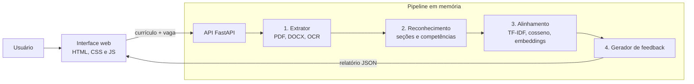
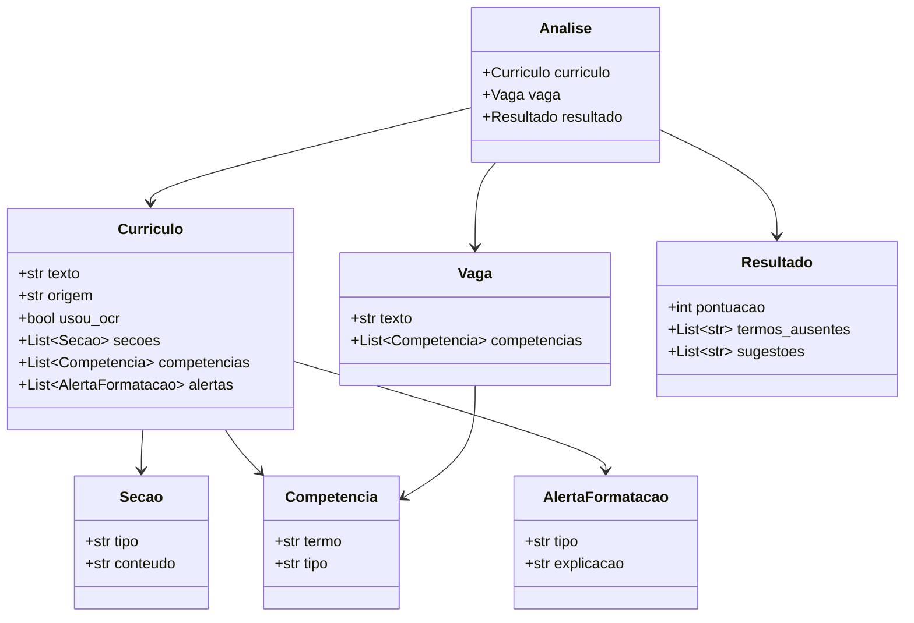

# Arquitetura e dados

> Situação: arquitetura proposta. Os componentes ainda não foram implementados e podem mudar durante o desenvolvimento.

## 1. Visão geral

O OtimizaCV será composto por uma interface web estática e uma API em Python. A interface envia o currículo e a vaga; a API executa um *pipeline* de quatro módulos e devolve o resultado em JSON. Nada é gravado em disco ou banco de dados.

## 2. Componentes

### 2.1 Interface web
Formulário para envio do arquivo ou colagem do texto, campo para a descrição da vaga e tela de resultado. HTML, CSS e JavaScript, sem framework.

### 2.2 API
Ponto de entrada `POST /analisar`, que recebe o arquivo (ou texto) e a vaga e devolve o relatório. Validação de tipo e tamanho do arquivo antes do processamento.

### 2.3 Módulo 1 — Extrator
- PDF digital: `pdfplumber`, preservando a posição dos blocos de texto para detectar colunas e tabelas.
- DOCX: `python-docx`, incluindo verificação de tabelas, cabeçalho e rodapé.
- PDF digitalizado: renderização da página e OCR com Tesseract (`pytesseract`).
- Saída: texto normalizado e uma lista de ocorrências de formatação (tabela, coluna, imagem, cabeçalho).

### 2.4 Módulo 2 — Reconhecimento (NER)
- Separação de seções por títulos conhecidos e por padrões de texto.
- Identificação de competências com `spaCy`, combinando modelo de língua portuguesa e regras sobre uma lista de competências.
- Classificação em *hard skills* e *soft skills*.

### 2.5 Módulo 3 — Alinhamento e pontuação
- **Correspondência lexical:** vetorização TF-IDF (`scikit-learn`) do currículo e da vaga e cálculo da similaridade de cosseno.
- **Correspondência semântica:** *embeddings* de frases (`sentence-transformers`, modelo multilíngue) para reconhecer termos equivalentes escritos de forma diferente, como “atendimento a usuários” e “suporte ao cliente”.
- **Pontuação final:** combinação ponderada das duas similaridades e da cobertura de competências da vaga, normalizada de 0 a 100. Os pesos serão definidos e documentados na fase de testes.

### 2.6 Módulo 4 — Gerador de feedback
Transforma os resultados dos módulos anteriores em mensagens curtas e explicadas: termos ausentes, competências encontradas com nome diferente e alertas de formatação.

## 3. Modelo de dados

Não há banco de dados. As estruturas abaixo existem apenas durante a requisição.

## 4. Decisões técnicas

| Decisão | Justificativa |
|---------|---------------|
| Python no back-end | Principais bibliotecas de PLN, OCR e aprendizado de máquina estão disponíveis em Python. |
| TF-IDF + *embeddings* em vez de apenas um deles | O TF-IDF reproduz a busca por palavras-chave que muitos ATS fazem; os *embeddings* captam equivalências de sentido. A combinação mostra ao usuário as duas perspectivas. A ideia de alinhar representações diferentes de um mesmo conteúdo se apoia na literatura de recuperação de informação entre mídias (Peng; Huang; Zhao, 2018). |
| Processamento só em memória | Currículos têm dados pessoais. Não armazenar elimina riscos de vazamento e simplifica a adequação à LGPD. |
| Sem cadastro de usuário | Reduz atrito para o público-alvo e evita coleta de dados desnecessária. |
| Interface sem framework | Escopo pequeno; mantém a página leve e fácil de publicar. |
| Explicar cada alerta | A literatura aponta falta de transparência nos sistemas de contratação algorítmica (Raghavan *et al.*, 2020); a ferramenta deve fazer o contrário. |
