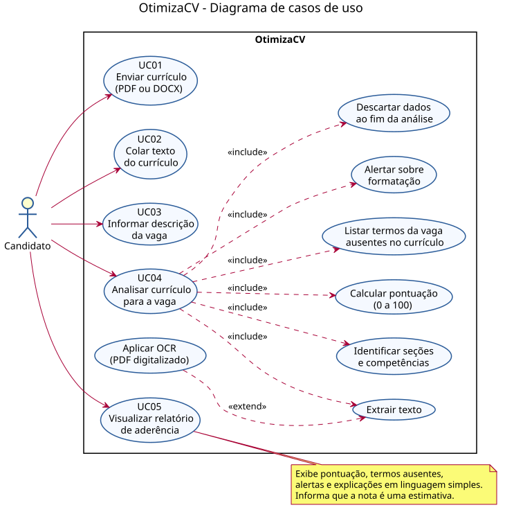

# Casos de uso do OtimizaCV

> Situação: documento de planejamento. Nenhum caso de uso foi implementado até o momento.

O diagrama abaixo descreve as interações entre o candidato e o OtimizaCV, com base nos requisitos de [requisitos.md](requisitos.md).

Código-fonte do diagrama (PlantUML): [diagramas/casos-de-uso.puml](diagramas/casos-de-uso.puml). Versão em imagem: [PNG](diagramas/casos-de-uso.png).

## Ator

| Ator | Descrição |
|------|-----------|
| Candidato | Estudante, recém-formado ou trabalhador que deseja verificar como seu currículo tende a ser lido por sistemas de triagem automática (ATS). Não há cadastro nem login. |

## Casos de uso principais

| ID | Caso de uso | Descrição | Requisitos |
|----|-------------|-----------|------------|
| UC01 | Enviar currículo (PDF ou DOCX) | O candidato envia o arquivo do currículo, com até 5 MB. | RF01, RNF06 |
| UC02 | Colar texto do currículo | O candidato cola o texto do currículo em vez de enviar um arquivo. | RF02 |
| UC03 | Informar descrição da vaga | O candidato cola o texto da vaga à qual deseja se candidatar. | RF03 |
| UC04 | Analisar currículo para a vaga | O sistema processa o currículo e a vaga e gera a análise de aderência. | RF04 a RF09 |
| UC05 | Visualizar relatório de aderência | O candidato vê a pontuação, os termos ausentes, os alertas de formatação e a explicação de cada item, com o aviso de que a nota é uma estimativa. | RF07, RF08, RF09, RF10, RNF07 |

## Casos de uso incluídos e estendidos

Os casos abaixo não são acionados diretamente pelo candidato. Fazem parte da execução do UC04.

| Caso de uso | Relação | Descrição | Requisitos |
|-------------|---------|-----------|------------|
| Extrair texto | include | Obtém o texto do arquivo enviado ou do texto colado. | RF04 |
| Aplicar OCR (PDF digitalizado) | extend | Só ocorre quando o PDF é uma imagem. Se a leitura for parcial, o sistema avisa o candidato. | RF04 |
| Identificar seções e competências | include | Reconhece as seções do currículo e as competências técnicas e comportamentais, no currículo e na vaga. | RF05, RF06 |
| Calcular pontuação (0 a 100) | include | Calcula a aderência entre currículo e vaga. | RF07 |
| Listar termos da vaga ausentes no currículo | include | Compara os termos relevantes da vaga com o currículo. | RF08 |
| Alertar sobre formatação | include | Detecta tabelas, colunas, imagens, cabeçalho e rodapé que dificultam a leitura automática. | RF09 |
| Descartar dados ao fim da análise | include | Remove arquivo e texto da memória, sem armazenamento nem registro em log. | RNF01 |

## Fluxo principal (UC01 a UC05)

1. O candidato envia o currículo (UC01) ou cola o texto (UC02).
2. O candidato informa a descrição da vaga (UC03).
3. O candidato solicita a análise (UC04).
4. O sistema extrai o texto, identifica seções e competências, calcula a pontuação, lista os termos ausentes e detecta problemas de formatação.
5. O sistema descarta os dados do currículo.
6. O candidato visualiza o relatório (UC05).

## Fluxos alternativos

- **Formato não suportado ou arquivo acima de 5 MB:** o sistema exibe uma mensagem de erro clara e não inicia a análise.
- **PDF digitalizado:** o sistema aplica OCR. Se a leitura for parcial, o relatório traz um aviso.
