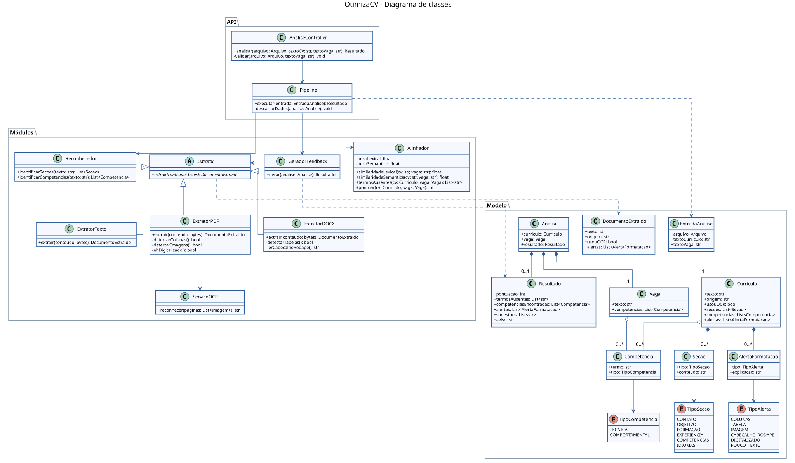
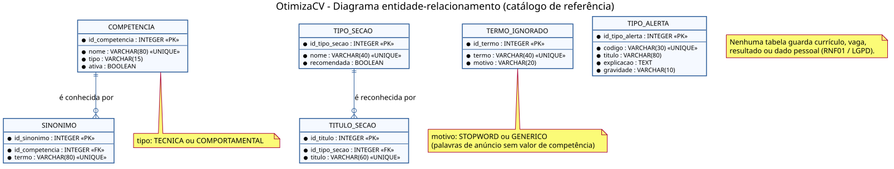

# Diagramas de classes e entidade-relacionamento

> Situação: modelagem proposta, alinhada à [arquitetura](arquitetura.md). As classes ainda não foram implementadas no back-end.

## 1. Diagrama de classes

Código-fonte (PlantUML): [diagramas/classes.puml](diagramas/classes.puml). Versão em imagem: [PNG](diagramas/classes.png).

As classes estão organizadas em três pacotes.

**API**

| Classe | Responsabilidade |
|--------|------------------|
| AnaliseController | Recebe a requisição `POST /analisar`, valida tipo e tamanho do arquivo e o tamanho da vaga, e devolve o resultado. |
| Pipeline | Executa os módulos na ordem prevista e descarta os dados ao final (RNF01). |

**Módulos**

| Classe | Responsabilidade | Requisitos |
|--------|------------------|------------|
| Extrator (abstrata) | Define a operação comum de extração de texto. | RF04 |
| ExtratorPDF | Extrai texto de PDF e detecta colunas, imagens e documentos digitalizados. | RF01, RF04, RF09 |
| ExtratorDOCX | Extrai texto de DOCX e detecta tabelas, cabeçalho e rodapé. | RF01, RF04, RF09 |
| ExtratorTexto | Trata o texto colado pelo usuário. | RF02 |
| ServicoOCR | Reconhece o texto de páginas digitalizadas. | RF04 |
| Reconhecedor | Identifica seções e competências técnicas e comportamentais. | RF05, RF06 |
| Alinhador | Calcula a similaridade lexical (TF-IDF e cosseno) e a semântica (*embeddings*), os termos ausentes e a pontuação de 0 a 100. | RF07, RF08 |
| GeradorFeedback | Monta o resultado com explicações em linguagem simples e o aviso de estimativa. | RF10, RNF07 |

**Modelo**

Estruturas que existem apenas durante a requisição: `EntradaAnalise`, `DocumentoExtraido`, `Analise`, `Curriculo`, `Vaga`, `Secao`, `Competencia`, `AlertaFormatacao` e `Resultado`, além das enumerações `TipoCompetencia`, `TipoSecao` e `TipoAlerta`.

Relações principais:

- `Analise` é composta por um `Curriculo`, uma `Vaga` e um `Resultado`. Quando a análise termina, todos são descartados juntos.
- `Curriculo` é composto por suas seções e alertas de formatação, e agrega as competências identificadas.
- `ExtratorPDF`, `ExtratorDOCX` e `ExtratorTexto` especializam `Extrator`, o que permite incluir novos formatos sem alterar o `Pipeline`.

## 2. Diagrama entidade-relacionamento

Código-fonte (PlantUML): [diagramas/entidade-relacionamento.puml](diagramas/entidade-relacionamento.puml). Versão em imagem: [PNG](diagramas/entidade-relacionamento.png).

Por decisão de projeto (RNF01 e LGPD), o OtimizaCV não armazena currículos, vagas, resultados nem qualquer dado pessoal. O banco de dados guarda apenas o **catálogo de referência** usado pelos módulos de reconhecimento e alinhamento, que hoje está fixo no código do protótipo. Mantê-lo em tabelas permite ampliar listas de competências e sinônimos sem alterar o programa.

| Entidade | Descrição | Usada por |
|----------|-----------|-----------|
| COMPETENCIA | Competência reconhecida pelo sistema, classificada como técnica ou comportamental. | Reconhecedor (RF06) |
| SINONIMO | Outras formas de escrever a mesma competência (ex.: “suporte ao usuário” e “atendimento a usuários”). | Reconhecedor, Alinhador (RF06, RF08) |
| TIPO_SECAO | Tipo de seção esperado no currículo (contato, formação, experiência etc.) e se é recomendada. | Reconhecedor (RF05) |
| TITULO_SECAO | Títulos que identificam cada tipo de seção (ex.: “Histórico profissional” para experiência). | Reconhecedor (RF05) |
| TERMO_IGNORADO | Palavras sem valor de competência: *stopwords* e termos genéricos de anúncio, como “vaga” e “empresa”. | Alinhador (RF07, RF08) |
| TIPO_ALERTA | Código, título, explicação e gravidade de cada alerta de formatação. | Extratores, GeradorFeedback (RF09, RF10) |

Relacionamentos:

- **COMPETENCIA 1 : N SINONIMO** — uma competência pode ter vários sinônimos; cada sinônimo pertence a uma única competência.
- **TIPO_SECAO 1 : N TITULO_SECAO** — um tipo de seção pode ser reconhecido por vários títulos; cada título indica um único tipo.

`TERMO_IGNORADO` e `TIPO_ALERTA` são tabelas independentes, consultadas diretamente pelos módulos.
